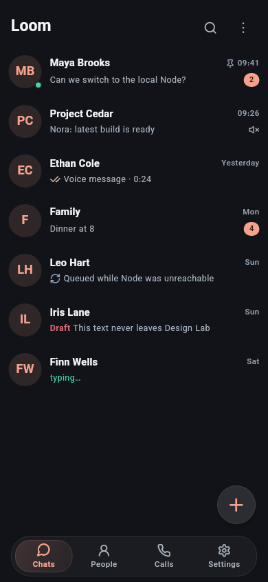
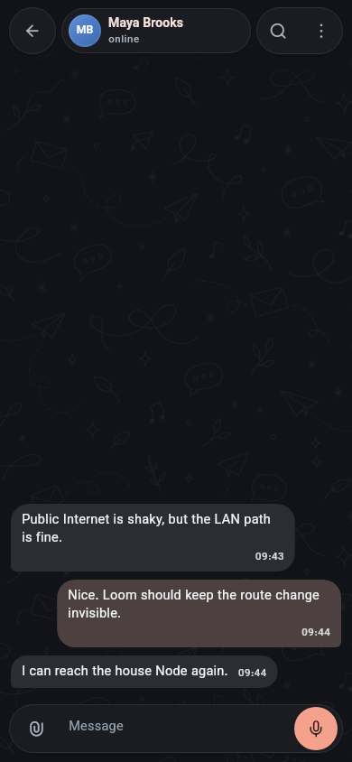
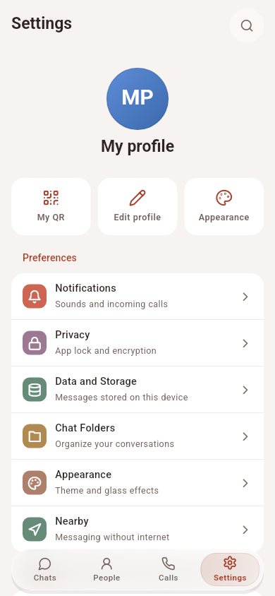
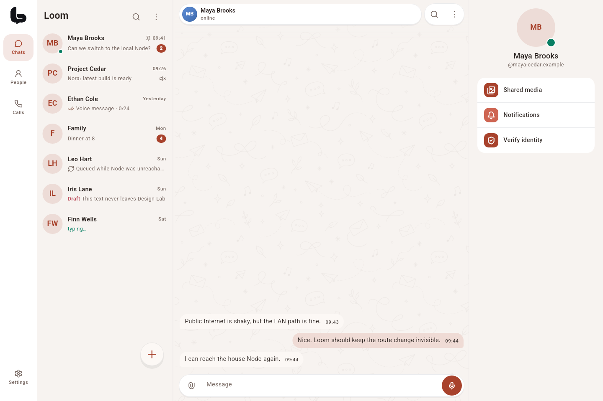
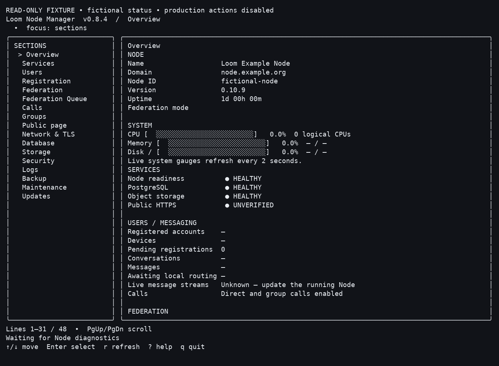
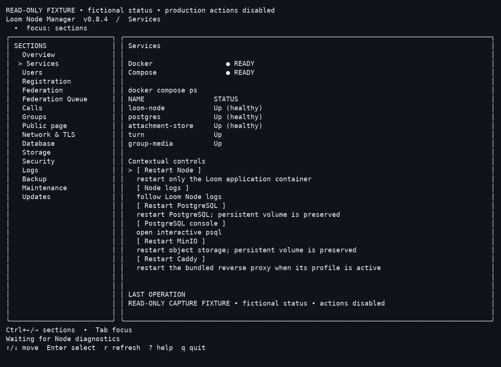
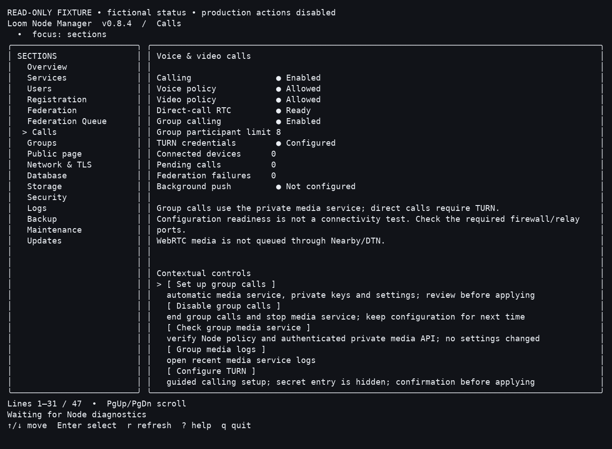
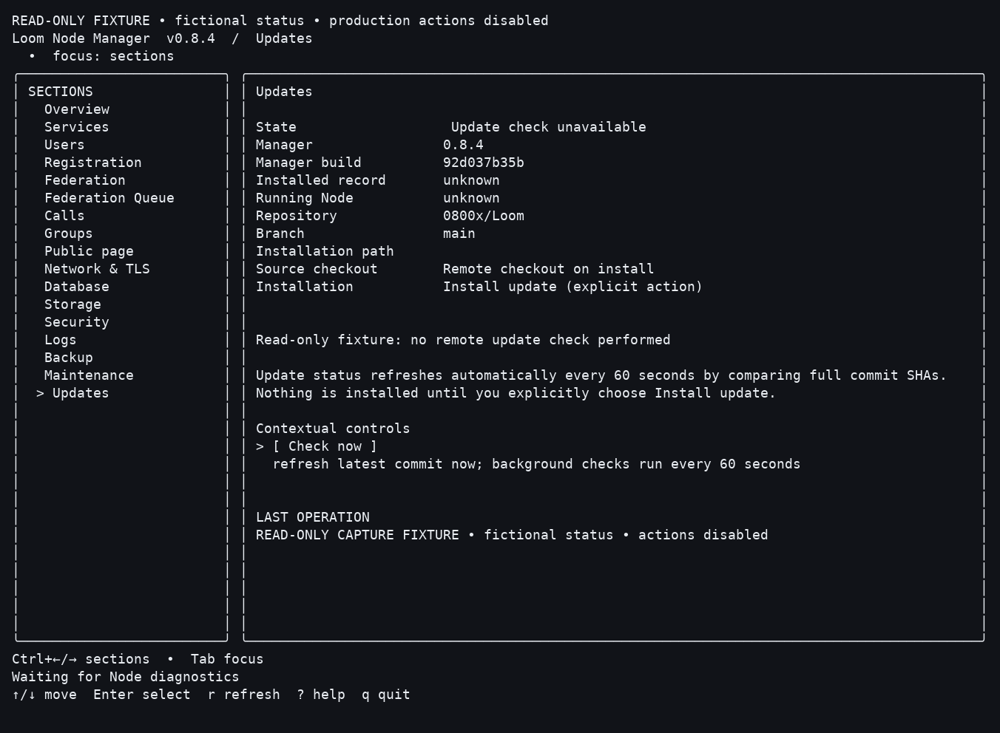

<div align="center">
  

# Loom

### Conversations that can take more than one route.

Encrypted messaging · Self-hosted Home Nodes · Android Nearby

**Repository version:** 0.3.0-alpha.1 · **License:** GPL-3.0-only

[Get started](#get-started) · [Host a Home Node](#host-a-home-node) · [Documentation](docs/README.md) · [Screenshots](#screenshots) · [Persian guide](#persian-home-node-guide) · [Telegram](https://t.me/LoomMessanger)
</div>

Loom is an open-source messenger for mobile and desktop. Choose a Home Node,
create an identity, and keep your conversations in one app. Messages can travel
through a Home Node, verified federated nodes, a local network, or compatible
Android devices encountered along the way.

> **Project status: alpha.** This is software for testing, not a promise of
> production-grade availability or anonymity. The project has not received an
> independent security audit. Keep a recovery backup and test with non-critical
> conversations before relying on a deployment.

## What Loom includes

| Conversations | Connectivity | Client experience |
| --- | --- | --- |
| Direct messages, photos, files, stickers and voice notes | Self-hosted Home Nodes | Android and desktop clients |
| MLS groups and invitations on a shared Home Node | Verified node federation | English and Persian |
| Voice and video calls | Verified local-network delivery | Right-to-left and left-to-right layouts |
| Music and video attachments | Android Nearby store / carry / forward | Light, dark and OLED themes |
| Account recovery and device linking | Optional TURN and group-call media services | Mobile and desktop interfaces |

Calls need a live network path. Group calls need the optional media service.
Nearby depends on supported Android hardware, OS support, permissions, compatible
peers and trusted device keys; it does not guarantee delivery or continuous
background operation.

## How messages travel

Messages are encrypted on the sending device and placed in a persistent local
outbox before delivery. The Home Node stores and routes encrypted envelopes;
authorized recipient devices decrypt their own messages. Attachments are
encrypted before upload, and their keys travel inside the encrypted message.

| Route | What it does | Important limit |
| --- | --- | --- |
| Home Node | Authenticated delivery and synchronization for an account | The operator can observe operational metadata, not decrypt properly end-to-end encrypted message content |
| Federation | Routes encrypted direct messages between compatible Home Nodes | Each operator controls trust; both directions must permit the peer |
| Local network | Delivers over a verified local route | Requires compatible devices and verified device information |
| Android Nearby | Stores, carries and forwards encrypted packets during compatible encounters | A carrier holding a packet is not proof that the recipient received it |

An intermediate node or carrier accepting a packet is not the same as recipient
delivery. A signed recipient receipt can return over a later route. Fully
offline read receipts are not implemented.

### Federation

A user can keep an account on one Home Node and message a user on another.
An address such as <code>ethan@chat.example.net</code> identifies the remote domain for
discovery. Loom fetches signed <code>/.well-known/loom/server</code> metadata over HTTPS,
checks the endpoint and node identity, and applies the operator's trust policy
before routing an authenticated encrypted envelope.

A valid signature establishes a node identity; it does not mean that you should
automatically trust that node. In **Trusted** mode, inspect and approve the peer
fingerprint in Node Manager. For two-way conversations, both nodes must permit
the connection. Federation does not currently provide cross-node MLS group
membership in this alpha.

### Groups and calls

MLS group membership and invitations currently use a shared Home Node. New
members do not automatically receive earlier group history. Account recovery
does not restore a lost MLS ratchet state.

Voice and video use authenticated signaling and live WebRTC media, with TURN
when configured. Group calls use the optional media service. Calls cannot be
stored in the delayed message outbox or carried by Nearby.

## Screenshots

The messenger images show real Flutter widgets with fictional contacts and
synthetic messages. Playback state is mocked. Terminal images show the Bubble
Tea Node Manager in an isolated fixture; the public node page is a browser
capture of a running local server. These captures do not establish hardware,
radio, media-playback or cross-network call support.

<table>
  <tr>
    <td align="center"><strong>Conversations</strong></td>
    <td align="center"><strong>Chat</strong></td>
    <td align="center"><strong>Settings</strong></td>
  </tr>
  <tr>
    <td></td>
    <td></td>
    <td></td>
  </tr>
</table>

### Desktop



### Node Manager

| Overview | Services |
| --- | --- |
|  |  |
| **Calling** | **Updates** |
|  |  |

[Capture provenance and image hashes](docs/screenshots/loom-current/provenance.json).

## Interface and design

Loom uses a shared design system, `loom_design`, across its client screens.
Layered glass surfaces, adaptive blur/refraction and restrained motion form
the visual language. Rendering quality can step down on slower devices, and
reduced-motion or reduced-transparency preferences are respected.

The three main appearance modes are **Porcelain** (light), **Midnight** (dark)
and **Void** (OLED). Shared semantic color roles keep components consistent
across the messenger and desktop interface. The debug-only **Design Lab**
renders the component gallery for development.

## Get started

1. Install Loom on a supported device using a validated project build or release artifact when available.
2. Add a trusted Home Node using its connection link or QR code. Review a changed server fingerprint before connecting.
3. Create an identity or restore your recovery kit. Keep recovery material private and offline.
4. Add a contact and start a conversation, or create a group on your Home Node.
5. Test messages and calls between devices on different networks before inviting other users.

The repository currently identifies version **0.3.0-alpha.1** as an unpublished
alpha snapshot. The Home Node bootstrap is available directly from the
repository's **main** branch and pins a specific source revision; it does not
require a versioned release asset. Client binaries and release availability
are tracked separately in the [release documentation](release/README.md).

## Host a Home Node

A Home Node is the server that stores account state, synchronizes encrypted
messages, serves attachments and provides the public connection endpoint for
your Loom clients. You operate it yourself; Loom does not assign a hosted domain
or run a managed public service for you.

### Requirements

- Linux on **amd64/x86_64 or arm64/aarch64**, booted with **systemd**.
- Root access or a sudo-capable account.
- Git, curl, OpenSSL, `ss`, `tar`, Docker Engine and Docker Compose v2. The bootstrap installs supported prerequisites when possible.
- A maintained Linux distribution with working vendor repositories.
- For a small initial deployment, start with **2 CPU cores and 4 GB RAM**. More capacity is needed as concurrent users, attachments and calls increase. A 1 GB RAM VPS is a constrained test host; do not enable group-call media on it.
- For public HTTPS, a DNS hostname and inbound reachability on TCP **80 and 443**.

The production installer uses prebuilt Node and MinIO images. The Home Node
does not compile the Loom server, Go tools, Node.js packages or MinIO on the
VPS. GitHub Actions builds and publishes those artifacts.

### Before running the installer

1. Create a DNS **A** record for your hostname that points to the VPS provider's public ingress IPv4.
2. If the hostname has an **AAAA** record, make sure that IPv6 address also reaches this server. Remove a stale AAAA record rather than leaving clients or certificate authorities to reach the wrong host.
3. For public certificate issuance, turn off a CDN/proxy layer for this hostname unless it is explicitly configured to pass the ACME challenge and forward the traffic correctly.
4. Allow inbound TCP **80 and 443** in the VPS provider firewall/security group and any host firewall. The installer opens these ports in active UFW or firewalld rules when applicable, but it cannot change the provider's external firewall.
5. Make the `loom-node` and `loom-minio` packages in GitHub Container Registry public so a fresh server can pull them.

### One-command installation or reconfiguration

Connect to the server over SSH and run:

```bash
curl --proto '=https' --tlsv1.2 -fsSL \
  https://raw.githubusercontent.com/0800x/Loom/main/install.sh \
  -o /tmp/loom-install.sh &&
bash /tmp/loom-install.sh
```

The installer downloads a bootstrap that pins and verifies an immutable source
revision and its archive before privileged setup. Use the official repository
URL above. Do not pipe an unverified branch snapshot directly into a root shell,
disable TLS verification, or remove the source-integrity checks.

The interactive wizard asks for the server hostname or IP and lets you select
the remaining options with **Up/Down** and **Enter**. On a basic terminal, add
`--text` to use line prompts. **Esc** cancels before installation starts.

### Wizard options

| Setting | Choices | Meaning |
| --- | --- | --- |
| Download sources | `official`, `liara`, `arvan` | Choose upstream sources or the supported regional mirrors described below |
| HTTPS mode | `public`, `local` | Public CA certificate, or a locally generated certificate that each client must explicitly trust |
| HTTPS proxy | `auto`, `caddy`, `nginx` | Preserve/detect a proxy, use bundled Caddy, or configure host Nginx with Certbot |
| Registration | `approval`, `open`, `closed` | Review new registrations, allow them automatically, or stop new registrations |
| Federation | `trusted`, `disabled`, `open` | Approved peers, no federation, or any compatible cryptographically verified peer |
| Voice calls | `auto`, `manual`, `off` | Configure local TURN, keep relay configuration operator-managed, or disable calling |
| Video calls | `yes`, `no` | Enable or disable video calling when calls are enabled |
| Group calls | `on`, `off`, `keep` | Install group media, disable it, or retain the existing setting during reconfiguration |

`auto` proxy mode preserves the existing Loom choice on reconfiguration. On a
fresh install it detects host Nginx when available; otherwise it uses bundled
Caddy. Public Caddy and public Nginx both need inbound TCP 80/443 for automatic
certificate issuance. Switching proxies does not bypass a provider firewall
or blocked inbound ports.

Local HTTPS uses Nginx and a locally generated certificate. The installer
prints the SHA256 fingerprint and the path to the public certificate:
`/opt/loom-node/deploy/tls-local/fullchain.pem`. Transfer **only** that public
certificate to the client, compare the fingerprint, and use Loom's
**Import local HTTPS certificate** action. Keep `privkey.pem` on the server.
Local certificates are not a silent fallback after a public certificate error.

### Regional download sources for servers in Iran

For a server whose route to upstream package registries is unreliable, choose
**Liara** or **Arvan** in the wizard, or pass `--downloads liara` or
`--downloads arvan` to the installer. The profiles redirect selected Docker Hub
image references and supported Ubuntu/Debian package-manager operations to
regional mirrors.

| Component | `liara` | `arvan` |
| --- | --- | --- |
| Docker Hub images used by the stack (for example PostgreSQL, Caddy and LiveKit) | `docker-mirror.liara.ir` | `docker.arvancloud.ir` |
| Ubuntu host package downloads | Temporary Liara APT sources (amd64) | Temporary Arvan Ubuntu APT sources (amd64) |
| Debian host package downloads | Temporary Liara APT sources | Temporary Liara Debian APT sources |
| Loom Node and MinIO images | GitHub Container Registry (`ghcr.io`) | GitHub Container Registry (`ghcr.io`) |
| GitHub bootstrap and source archive | GitHub | GitHub |

The mirror profile does **not** change the entire server's network route.
It does not install a VPN, proxy arbitrary HTTPS traffic, tunnel inbound
connections, or make every blocked service reachable. In particular:

- The bootstrap and source archive still come from GitHub.
- Loom Node and MinIO images still come from GHCR; the Docker Hub prefix does
  not rewrite `ghcr.io`.
- The public HTTPS certificate authority must still be reachable in `public`
  mode.
- For distributions other than Ubuntu and Debian, host packages continue to
  use the repositories configured for that distribution.
- Ubuntu ARM64 uses Ubuntu Ports; the built-in APT mirror profile does not
  configure that repository automatically.
- When a mirror profile must install Docker Engine from distribution packages,
  the automated fresh-install route covers Ubuntu and Debian 13+. On an older
  Debian release, provide a working Docker Engine plus Compose v2 first, or
  use the official package route where your network permits it.
- Home Node setup is pull-only. It does not locally compile Go, run npm
  installs or build Alpine-based images. Go/npm/Alpine mirror settings belong
  to separate maintainer build workflows, not a magic fix for a blocked GHCR
  or GitHub connection.

These profiles keep TLS, repository signatures, immutable source verification
and any image digest pins already defined by the deployment enabled. The
installer does not silently fall back to another mirror after a download or
checksum error. If a selected mirror is unavailable, rerun setup and explicitly
choose another source. Mirror availability and terms are controlled by their
operators; verify the provider's current service status before depending on it.

Provider references: [Liara Docker](https://docs.liara.ir/mirrors/docker/),
[Liara Ubuntu](https://docs.liara.ir/mirrors/ubuntu/),
[Liara Debian](https://docs.liara.ir/mirrors/debian/),
[Arvan Docker](https://www.arvancloud.ir/fa/dev/docker),
[Arvan Linux repositories](https://www.arvancloud.ir/fa/dev/linux-repository).

### Public network ports

| Feature | Inbound ports | Notes |
| --- | --- | --- |
| Home page, messaging, discovery and public HTTPS | TCP 80, 443 | Required for public proxy and certificate setup |
| Caddy HTTP/3 | UDP 443 | Optional transport; TCP 443 is still required |
| TURN voice/video relay | TCP and UDP 3478; UDP 49160–49200 | Needed when local TURN is selected |
| Group-call media | TCP 7881; UDP 50000–50100 | Needed only when group calls are enabled |

The database, object-storage ports, Node's internal port 7483 and the group
media control port 7880 are not intended to be exposed publicly. The Node
container binds to `127.0.0.1:7483`; Caddy or host Nginx proxies public HTTPS
to that loopback address.

### After installation

The terminal Node Manager opens after setup. Run `loom` to open it again
(`loom-node` is an alias). Arrow keys select items, **Tab** changes focus,
**Enter** opens an action, **?** displays help, **r** refreshes and **q** exits
the interface. Exiting the interface does not stop the server.

Useful commands:

```bash
loom                 # Open Node Manager
loom setup           # Reopen the verified setup wizard
loom doctor          # Diagnose services and readiness
loom stop            # Stop the Home Node without deleting data
loom start           # Start the existing Home Node
```

Use **Overview** and **Services** to check readiness. Use **Registrations**
to approve new accounts when registration is set to `approval`. Use
**Federation** to inspect fingerprints and approve peers. Use **Calls** to
configure TURN or group-call media, and **Network & TLS** to diagnose public
connectivity and certificate expiry.

To connect a client, open `https://YOUR_DOMAIN` from another network and scan
the QR code or use the connection link. Test sending and receiving messages
between two physical devices. Test calls on different networks; a healthy
container or a passing control-plane check does not prove that the provider
firewall permits media traffic.

### Updating and preserving data

Node Manager checks the configured update channel while it is running.
A check does not install anything automatically. Review **Updates → Install
update** to apply a publisher-approved immutable revision.

Rerunning the verified Home Node installer is also supported. Existing
configuration, `.env` secrets, Node identity and persistent data are preserved
when the install directory is intact. Never delete Docker volumes as a routine
troubleshooting step. Keep backups of the database, attachments, Node identity
and configuration. Do not publish `.env`, database credentials, admin tokens,
TURN secrets, private keys or recovery phrases.

For manual update recovery and prepared transfers, see
[updates and offline transfer](docs/loom-node-update-and-offline.md). A source
bundle is not a complete offline fresh-install bundle; offline deployments
must also stage every required image and package separately.

## Security and compatibility notes

- Loom does not promise anonymity. A Home Node operator can see operational
  metadata such as account activity, timing and routing.
- The shipping direct-message scheme, **Loom-Direct-v1**, uses per-device
  sealed boxes. It does not currently provide a ratchet, forward secrecy or
  post-compromise security. The experimental session provider v2 is not enabled
  for production sends.
- MLS groups currently require a shared Home Node. Account recovery does not
  restore lost group ratchet state.
- Nearby delivery is opportunistic. Carrier custody is not recipient delivery.
- The alpha protocol namespace is not wire-compatible with earlier namespaces.
  Upgrade participating clients and nodes together. Conversation history and
  MLS state are not automatically converted.
- The 24-word recovery entropy-to-Ed25519 derivation is unchanged; restoring
  the same words preserves the public key and fingerprint. Keep the recovery
  kit secure and do not share it with an operator or support volunteer.

See [compatibility](docs/compatibility.md), [architecture notes](docs/architecture-v2.md)
and the [deployment reference](services/loom_server/deploy/README.md).

## Build from source

From the repository root:

```bash
git clone https://github.com/0800x/Loom.git
cd Loom/apps/loom
flutter pub get
flutter analyze
flutter test
flutter run
```

Flutter 3.44+ and Dart 3.12+ are required. Native cryptographic libraries
require Rust. Android builds also need the Android SDK, NDK and Java.

| Target | Architecture | Packaging / status |
| --- | --- | --- |
| Android client | ARMv7, ARM64, x86_64 | Separate APKs; optional universal APK through the build script |
| Windows client | x64 | ZIP and installer workflows |
| Linux client | x64 | Application bundle; see [runtime dependencies](release/linux-runtime.md) |
| macOS client | Intel x64, Apple Silicon arm64 | App ZIP and DMG; ad-hoc signed, not notarized |
| Linux Home Node | amd64, arm64 | Docker images and terminal manager built by GitHub Actions |

Build and signing state is tracked in the [artifact matrix](release/ARTIFACT-MATRIX.md).
Physical-device background delivery, radio support, media playback and
cross-network calling still need validation on actual devices and networks.

### Android build on Windows

From the repository root:

```powershell
powershell -NoProfile -ExecutionPolicy Bypass -File .\scripts\build-android.ps1
```

The script builds `armeabi-v7a`, `arm64-v8a` and `x86_64`. Keep the existing
release keystore for future updates. Missing release credentials do not fall
back to debug signing. See [Android signing](docs/android-release-signing.md).

## Repository map

| Path | Contents |
| --- | --- |
| `apps/loom` | Flutter messenger |
| `apps/loom_node_ui` | Desktop Node management UI |
| `packages/loom_*` | Shared UI, storage, transport and cryptographic packages |
| `services/loom_server` | Node runtime, deployment and server APIs |
| `tools/loom_node_manager` | Terminal Home Node manager |
| `native` | Native cryptographic implementations |
| `docs` | Protocol, deployment, client and operator documentation |

## Support development

Help fund development, testing and device support.

<p>
  <a href="https://nowpayments.io/donation/loom" target="_blank" rel="noopener noreferrer">
    
  </a>
</p>

| Currency | Network | Address |
| --- | --- | --- |
| USDT | BNB Smart Chain · BEP-20 | `0x5D303A4DF69C5058c70E0ECf3280BDA600824685` |
| USDT | Ethereum · ERC-20 | `0x5D303A4DF69C5058c70E0ECf3280BDA600824685` |

Choose the matching network when sending. Project funding is separate from
support for an individual operator's Home Node.

## License

Loom is licensed under **GNU General Public License, version 3 only
(GPL-3.0-only)**. See [LICENSE](LICENSE) and [COPYRIGHT](COPYRIGHT).
Third-party components retain their own licenses.

---

<a id="persian-home-node-guide"></a>

# راهنمای فارسی کامل لوم و راه‌اندازی Home Node

لوم یک پیام‌رسان متن‌باز برای موبایل و دسکتاپ است. شما می‌توانید سرور خانگی
خودتان را روی VPS یا سرور شخصی اجرا کنید، اطلاعات حساب و پیوست‌ها را نگه دارید
و کاربران را از طریق لینک یا QR به نود متصل کنید.

**وضعیت پروژه:** نسخهٔ مخزن `0.3.0-alpha.1` و در مرحلهٔ آلفاست. این نسخه
هنوز ممیزی امنیتی مستقل ندارد؛ برای آزمایش و استفادهٔ غیرحیاتی مناسب‌تر است.
از عبارت «رمزگذاری‌شده» نباید نتیجه گرفت که ناشناس هستید یا اپراتور هیچ
اطلاعاتی نمی‌بیند. زمان اتصال، حساب و فرادادهٔ مسیریابی همچنان قابل مشاهده‌اند.

## نصب سریع با یک کپی و اجرا

برای سرور خارج از ایران یا سروری که به GitHub، GHCR و مخازن اصلی دسترسی دارد،
از SSH وارد سرور شوید و کل این دستور را کپی کنید:

```bash
curl --proto '=https' --tlsv1.2 -fsSL \
  https://raw.githubusercontent.com/0800x/Loom/main/install.sh \
  -o /tmp/loom-install.sh &&
bash /tmp/loom-install.sh
```

نصب‌کننده منوی تعاملی را باز می‌کند. فقط دامنه یا آدرس سرور را تایپ کنید؛
بقیهٔ انتخاب‌ها با کلیدهای بالا و پایین و Enter انجام می‌شوند. در پایان خلاصه
را مرور کنید و نصب را تأیید کنید.

برای نصب روی سرور ایران، یکی از دو دستور زیر را به‌جای دستور بالا اجرا کنید.

**سرور ایران با میرور لیارا:**

```bash
curl --proto '=https' --tlsv1.2 -fsSL \
  https://raw.githubusercontent.com/0800x/Loom/main/install.sh \
  -o /tmp/loom-install.sh &&
bash /tmp/loom-install.sh --downloads liara
```

**سرور ایران با میرور آروان:**

```bash
curl --proto '=https' --tlsv1.2 -fsSL \
  https://raw.githubusercontent.com/0800x/Loom/main/install.sh \
  -o /tmp/loom-install.sh &&
bash /tmp/loom-install.sh --downloads arvan
```

این دو فرمان همان نصب‌کنندهٔ رسمی را اجرا می‌کنند؛ فقط پروفایل دریافت
وابستگی‌ها را از قبل انتخاب می‌کنند. در ویزارد می‌توانید گزینه‌های دیگر را
هم تغییر دهید. انتخاب منبع، رمزها یا داده‌های نصب قبلی را پاک نمی‌کند.

## پیش‌نیازهای سرور

برای شروع یک سرور لینوکسی با حداقل شرایط زیر در نظر بگیرید:

- معماری x86_64/amd64 یا arm64/aarch64 و سیستم‌عامل لینوکس دارای systemd.
- دسترسی root یا کاربر دارای sudo.
- حداقل پیشنهادی برای شروع: ۲ هستهٔ CPU و ۴ گیگابایت RAM. با افزایش کاربران،
  فایل‌ها و تماس‌ها به منابع بیشتری نیاز دارید.
- دامنه یا زیردامنه برای HTTPS عمومی و IPv4 عمومی قابل دسترسی.
- پورت‌های ورودی TCP 80 و 443 در فایروال پنل شرکت میزبان و فایروال سیستم.
- دسترسی سرور به GitHub و GitHub Container Registry برای دریافت سورس و ایمیج‌های
  اختصاصی Loom.

سرور یک هسته و یک گیگابایت RAM ممکن است برای آزمایش محدود بالا بیاید، اما
منبع مناسبی برای استفادهٔ جدی یا تماس گروهی نیست. روی چنین سروری تماس گروهی
را خاموش نگه دارید و مصرف RAM را زیر نظر بگیرید.

## اتصال دامنه و آماده‌سازی DNS

1. یک رکورد A برای زیردامنهٔ موردنظر بسازید؛ برای مثال `chat.example.com`.
2. مقدار A باید IPv4 عمومی ورودی‌ای باشد که شرکت VPS به شما اختصاص داده است.
3. اگر رکورد AAAA دارید، IPv6 آن نیز باید به همین سرور برسد. اگر IPv6 تنظیم
   نشده، رکورد AAAA اشتباه یا قدیمی را حذف کنید.
4. برای صدور گواهی عمومی، پروکسی CDN را روی این hostname خاموش کنید؛ مگر اینکه
   خودتان مطمئن باشید درخواست ACME را درست عبور می‌دهد.
5. در فایروال پنل VPS و فایروال سیستم، TCP 80 و TCP 443 را باز کنید.

تفاوت مهم: IP کارت شبکه، IP خروجی اینترنت و IP عمومی ورودی الزاماً یکی نیستند.
اگر شرکت VPS از NAT استفاده می‌کند، DNS باید به IP عمومی ورودی اختصاص‌یافته
از طرف همان شرکت اشاره کند و پورت‌های 80 و 443 باید به VPS منتقل شوند.

## انتخاب‌های نصب‌کننده

| گزینه | انتخاب‌ها | توضیح |
| --- | --- | --- |
| Download sources | `official`، `liara`، `arvan` | منبع اصلی، میرور لیارا یا میرور آروان |
| HTTPS mode | `public`، `local` | گواهی عمومی معتبر یا گواهی محلی با اعتماد دستی روی کلاینت |
| HTTPS proxy | `auto`، `caddy`، `nginx` | تشخیص خودکار، Caddy داخلی یا Nginx میزبان |
| Domain | دامنه یا IPv4 | آدرس سرور، بدون `https://` و بدون مسیر |
| Registration | `approval`، `open`، `closed` | تأیید دستی ثبت‌نام، ثبت‌نام آزاد یا غیرفعال |
| Federation | `trusted`، `disabled`، `open` | نودهای مورد اعتماد، خاموش یا همهٔ نودهای سازگار با هویت معتبر |
| Voice calls | `auto`، `manual`، `off` | نصب خودکار TURN، مدیریت دستی یا خاموش |
| Video calls | `yes`، `no` | فعال یا غیرفعال بودن تماس تصویری |
| Group calls | `on`، `off`، `keep` | نصب سرویس رسانه، خاموش یا حفظ تنظیم فعلی |

برای بیشتر نصب‌های عمومی، گزینه‌های زیر نقطهٔ شروع مناسبی هستند:

- HTTPS mode: `public`
- HTTPS proxy: `auto` یا `caddy`
- Registration: `approval`
- Federation: `trusted`
- Voice calls: `auto`
- Group calls: اگر واقعاً به تماس گروهی نیاز ندارید، `off`

در حالت `approval` درخواست ساخت حساب را در Node Manager تأیید می‌کنید.
در حالت `open` ثبت‌نام خودکار است و باید آگاهانه انتخاب شود. در حالت
`trusted` فدراسیون به معنی اعتماد خودکار به همه نیست؛ هر نود باید بررسی و
تأیید شود.

### Caddy یا Nginx؟

- **Caddy:** پراکسی داخلی Loom است و گواهی عمومی را خودکار از مرجع صدور
  می‌گیرد و تمدید می‌کند. انتخاب ساده‌تر برای نصب تازه است.
- **Nginx:** روی خود سیستم نصب می‌شود و Certbot گواهی را می‌گیرد و تمدید
  می‌کند. اگر از قبل Nginx میزبان دارید، می‌تواند انتخاب مناسبی باشد.
- **auto:** در نصب مجدد انتخاب قبلی Loom را حفظ می‌کند؛ در نصب تازه Nginx
  فعال را تشخیص می‌دهد و در غیر این صورت Caddy را انتخاب می‌کند.

هر دو حالت HTTPS عمومی به ورودی TCP پورت‌های 80 و 443 نیاز دارند. عوض کردن
Caddy به Nginx مشکل بسته بودن پورت در فایروال دیتاسنتر یا NAT را حل نمی‌کند.
پورت عمومی 7483 را باز نکنید؛ این پورت فقط روی loopback سرور منتشر می‌شود.

### HTTPS محلی بدون دامنهٔ عمومی

اگر سرور فقط در LAN یا شبکهٔ خصوصی استفاده می‌شود، گزینهٔ `local` را انتخاب
کنید و یک hostname قابل resolve در شبکه یا IPv4 سرور بدهید. در این حالت
گواهی محلی ساخته می‌شود و صدور گواهی از Let's Encrypt لازم نیست.

بعد از نصب، فایل عمومی زیر را به شکل امن به دستگاه منتقل کنید:

`/opt/loom-node/deploy/tls-local/fullchain.pem`

اثر انگشت SHA256 چاپ‌شده در ترمینال را با فایل و دستگاه مقایسه کنید و در Loom
گزینهٔ **Import local HTTPS certificate** را انتخاب کنید. فقط `fullchain.pem`
عمومی را منتقل کنید؛ فایل `privkey.pem` کلید خصوصی سرور است و نباید از سرور
خارج شود. این روش برای کلاینت‌ها نیازمند اعتماد دستی است و جایگزین خودکار
گواهی عمومی نیست.

## استفاده از Liara و Arvan برای سرورهای ایران

این دو پروفایل برای زمانی هستند که سرور داخل ایران به بعضی مخازن اصلی دسترسی
پایدار ندارد. انتخاب آن‌ها آدرس بخشی از مخازن را عوض می‌کند؛ VPN، تونل عمومی
یا پراکسی تمام‌منظوره نصب نمی‌کنند و تمام محدودیت‌های شبکه را دور نمی‌زنند.

### Liara

در منوی Download sources گزینهٔ `liara` را انتخاب کنید یا دستور مخصوص آن
را از بخش نصب سریع اجرا کنید.

این پروفایل برای ایمیج‌های Docker Hub از پیشوند `docker-mirror.liara.ir`
استفاده می‌کند. بسته‌های Ubuntu amd64 و Debian نیز هنگام اجرای دستورات APT
از مخازن موقت Liara دریافت می‌شوند.

### Arvan

در منوی Download sources گزینهٔ `arvan` را انتخاب کنید یا دستور زیر را اجرا کنید:

```bash
bash /tmp/loom-install.sh --downloads arvan
```

این پروفایل برای ایمیج‌های Docker Hub از `docker.arvancloud.ir` استفاده
می‌کند. بسته‌های میزبان Ubuntu amd64 از میرور Ubuntu آروان دریافت می‌شوند؛
بسته‌های Debian همچنان از میرور Debian لیارا استفاده می‌کنند.

### دقیقاً چه چیزهایی از میرور دریافت می‌شوند؟

| وابستگی | Liara | Arvan |
| --- | --- | --- |
| ایمیج‌های Docker Hub مثل PostgreSQL، Caddy و LiveKit | میرور Docker لیارا | میرور Docker آروان |
| بسته‌های Ubuntu amd64 | میرور APT لیارا | میرور APT آروان |
| بسته‌های Debian | میرور APT لیارا | میرور APT لیارا |
| ایمیج اختصاصی Loom Node | GHCR | GHCR |
| ایمیج اختصاصی Loom MinIO | GHCR | GHCR |
| اسکریپت نصب و سورس Loom | GitHub | GitHub |

**نکتهٔ بسیار مهم:** ایمیج‌های اصلی Loom یعنی Node و MinIO از
`ghcr.io/0800x` دریافت می‌شوند. پروفایل Docker آروان یا لیارا آدرس GHCR را
تغییر نمی‌دهد. فایل نصب و سورس اولیه نیز همچنان از GitHub دریافت می‌شود.
پس اگر دسترسی سرور به GitHub یا GHCR کاملاً مسدود باشد، انتخاب Liara یا
Arvan به‌تنهایی نصب را کامل نمی‌کند.

در سیستم‌عامل‌های غیر از Ubuntu و Debian، بسته‌های میزبان از مخازن از قبل
تنظیم‌شدهٔ همان توزیع استفاده می‌کنند. Ubuntu ARM64 نیز از Ubuntu Ports
استفاده می‌کند و پروفایل داخلی این نصب‌کننده آن را خودکار تنظیم نمی‌کند.
برای نصب تازهٔ Docker Engine با پروفایل میرور، مسیر خودکار روی Ubuntu و
Debian 13 به بالا پشتیبانی می‌شود. روی Debian قدیمی‌تر، Docker Engine و
Compose v2 را از قبل آماده کنید یا در صورت دسترسی از مسیر رسمی بسته‌ها استفاده
کنید.

امضای بسته‌ها، TLS، هش آرشیو سورس و digest ایمیج‌های ثابت غیرفعال نمی‌شوند.
اگر میرور انتخاب‌شده در دسترس نباشد، نصب متوقف می‌شود؛ نصب‌کننده بی‌صدا
به منبع دیگری نمی‌پرد. برای تغییر منبع، ویزارد را دوباره با انتخاب صریح
پروفایل موردنظر اجرا کنید.

**این نصب کاملاً آفلاین نیست.** برای نصب تازه هنوز دسترسی به GitHub، GHCR،
بسته‌هایی که در میرور cache نشده‌اند و در حالت public به مرجع صدور گواهی
لازم است. این میرورها فقط مسیرهای مشخصی از دریافت وابستگی‌ها را پوشش می‌دهند.

### دستور نصب بدون منوی انتخاب منبع

برای سرور ایران و انتخاب آروان:

```bash
curl --proto '=https' --tlsv1.2 -fsSL \
  https://raw.githubusercontent.com/0800x/Loom/main/install.sh \
  -o /tmp/loom-install.sh &&
bash /tmp/loom-install.sh --downloads arvan
```

برای لیارا فقط `--downloads arvan` را با `--downloads liara` عوض کنید.
دامنه و سایر تنظیمات همچنان در ویزارد پرسیده می‌شوند.

### نصب متنی یا کاملاً از پیش‌تنظیم‌شده

اگر ترمینال با منوی فلش‌دار مشکل دارد، `--text` را اضافه کنید تا انتخاب‌ها
به‌صورت سؤال و جواب متنی نمایش داده شوند:

```bash
bash /tmp/loom-install.sh --text --downloads arvan
```

اگر همهٔ مقادیر را از قبل می‌دانید، می‌توانید ویزارد را بدون پرسش تعاملی
اجرا کنید. دامنهٔ خودتان را جایگزین کنید:

```bash
bash /tmp/loom-install.sh \
  --downloads arvan \
  --tls public \
  --proxy caddy \
  --domain chat.example.ir \
  --registration approval \
  --federation trusted \
  --turn auto \
  --video yes \
  --group-calls off \
  --yes \
  --no-manager
```

در این حالت `--yes` خلاصهٔ نهایی را تأیید می‌کند؛ فقط وقتی درست است که
تمام گزینه‌های لازم، به‌ویژه دامنه، را خودتان وارد کرده باشید.

## پورت‌هایی که باید باز باشند

| قابلیت | پروتکل و پورت | توضیح |
| --- | --- | --- |
| صفحهٔ عمومی، پیام‌رسانی و HTTPS | TCP 80 و 443 | برای HTTPS عمومی الزامی |
| HTTP/3 در Caddy | UDP 443 | اختیاری؛ TCP 443 همچنان لازم است |
| TURN تماس صوتی/تصویری | TCP و UDP 3478، UDP 49160–49200 | در صورت انتخاب TURN محلی |
| رسانهٔ تماس گروهی | TCP 7881، UDP 50000–50100 | فقط اگر تماس گروهی فعال باشد |

نصب‌کننده اگر UFW یا firewalld فعال باشد، قوانین میزبان را برای سرویس‌های
انتخاب‌شده تنظیم می‌کند. فایروال پنل شرکت VPS را خودتان تنظیم کنید.
پورت PostgreSQL، پنل MinIO، پورت داخلی 7880 و پورت 7483 نباید عمومی شوند.

## بعد از نصب چه کار کنم؟

1. صفحهٔ `https://YOUR_DOMAIN` را از یک شبکهٔ دیگر باز کنید.
2. در موبایل Loom گزینهٔ افزودن Home Node را انتخاب و QR یا لینک صفحه را
   اسکن کنید.
3. هویت تازه بسازید یا recovery kit خودتان را بازیابی کنید.
4. اگر Registration روی `approval` است، درخواست کاربر را در Node Manager
   از صفحهٔ Registrations تأیید کنید.
5. با دو دستگاه روی دو شبکهٔ متفاوت پیام بفرستید و تماس را آزمایش کنید.

برای باز کردن پنل مدیریتی:

```bash
loom
```

کلیدهای جهت برای حرکت، Tab برای تغییر پنل، Enter برای انتخاب، `?` برای راهنما
و `q` برای خروج هستند. خروج از پنل، سرور را خاموش نمی‌کند.

فرمان‌های مهم:

```bash
loom         # باز کردن Node Manager
loom setup   # باز کردن دوبارهٔ ویزارد
loom doctor  # بررسی وضعیت و عیب‌یابی
loom stop    # توقف سرویس‌ها بدون حذف داده
loom start   # راه‌اندازی دوبارهٔ سرویس‌ها
```

برای تغییر تنظیمات، `loom setup` را اجرا کنید. تنظیمات قبلی به‌عنوان مقدار
پیش‌فرض نمایش داده می‌شوند. اجرای مجدد نصب‌کننده نیز `.env`، رمزهای معتبر،
هویت نود، دیتابیس و فایل‌های ذخیره‌شده را حفظ می‌کند؛ volumeها را برای
عیب‌یابی معمولی حذف نکنید.

به‌روزرسانی‌ها هنگام باز بودن Node Manager بررسی می‌شوند، اما خودکار نصب
نمی‌شوند. برای نصب نسخهٔ تأییدشده به **Updates → Install update** بروید.

## معماری و محدودیت‌های امنیتی

- پیام مستقیم در نسخهٔ فعلی با Loom-Direct-v1 و sealed boxهای دستگاهی
  رمزگذاری می‌شود؛ ratchet، forward secrecy و post-compromise security
  هنوز در مسیر ارسال production وجود ندارند.
- گروه‌های MLS در این آلفا به Home Node مشترک نیاز دارند.
- اپراتور نود می‌تواند فرادادهٔ عملیاتی مانند زمان، حساب و مسیر ارتباط را ببیند.
- Nearby مسیر فرصت‌طلبانه است، نه تضمین تحویل آفلاین.
- این نسخه با namespace پروتکل قدیمی سازگار نیست؛ کلاینت‌ها و نودهای
  آزمایشی را با هم ارتقا دهید. سابقهٔ گفتگو و state گروه به‌صورت خودکار
  تبدیل نمی‌شود.
- فایل `.env`، توکن مدیریت، رمز دیتابیس، secret تماس، کلید خصوصی TLS و
  recovery kit را منتشر نکنید.

مستندات تکمیلی:

- [راهنمای مدیر نود](docs/node-manager.md)
- [نصب و استقرار پیشرفته](services/loom_server/deploy/README.md)
- [آپدیت و انتقال آفلاین](docs/loom-node-update-and-offline.md)
- [سازگاری نسخه‌ها](docs/compatibility.md)
- [مستندات فارسی نصب Home Node](docs/node-setup.fa.md)

## ساخت برنامه از سورس

برای ساخت کلاینت، Flutter نسخهٔ 3.44 یا جدیدتر و Dart نسخهٔ 3.12 یا جدیدتر
لازم است. کتابخانه‌های بومی رمزنگاری به Rust نیاز دارند و ساخت اندروید به
Android SDK، NDK و Java نیاز دارد. دستورها و وضعیت خروجی‌ها در بخش انگلیسی
و [ماتریس Artifact](release/ARTIFACT-MATRIX.md) آمده است.

## مجوز

لوم تحت مجوز **GPLv3-only** منتشر می‌شود. فایل‌های [LICENSE](LICENSE) و
[COPYRIGHT](COPYRIGHT) و مجوزهای اجزای ثالث را بررسی کنید.