<div align="center">
  

# Loom

### Conversations that can take more than one route.

Encrypted messaging · Self-hosted nodes · Android Nearby

`0.1.0-alpha.1`

<details>
<summary>Builds and project activity</summary>

<p>
  <a href="https://github.com/0800x/Loom/actions/workflows/loom-alpha.yml"></a>
  <a href="https://github.com/0800x/Loom/releases"></a>
  <a href="https://github.com/0800x/Loom/releases"></a>
  <a href="https://github.com/0800x/Loom/stargazers"></a>
  <a href="https://github.com/0800x/Loom/network/members"></a>
  <a href="LICENSE"></a>
  <a href="https://hits.sh/github.com/0800x/Loom/"></a>
</p>

Public activity badges become available when the repository is public.

</details>

[Get started](#get-started) · [Screenshots](#screenshots) · [Documentation](docs/README.md) · [Telegram](https://t.me/LoomMessanger) · [فارسی](README.fa.md)

</div>

Loom is a messenger for mobile and desktop. Choose a Home Node, create your
identity, and keep your conversations in one app. Messages can travel through
verified nodes, a local network, or compatible Android devices encountered along
the way.

This first alpha is for testing. Native media, background behavior and Nearby
still need device testing. Keep a recovery backup; the project has not received
an independent security audit.

## Inside Loom

| Conversations | Connections | Your device |
| --- | --- | --- |
| Direct messages and MLS groups | Self-hosted Home Nodes | English and Persian |
| Photos, files and stickers | Verified federation | LTR and RTL layouts |
| Voice notes, video and music | Verified local delivery | Light, dark and OLED themes |
| Voice and video calls | Android store/carry/forward | Recovery and device linking |

Group calls require a media service configured by the node operator. Nearby
requires supported hardware, permissions, compatible peers and trusted device
keys. Calls require live connectivity.

## Screenshots

The messenger images render the actual Flutter widgets with fictional contacts
and synthetic messages. Playback state is mocked. The terminal images capture the
running Bubble Tea interface in an isolated, read-only fixture. The node page is
a browser capture of a running local server.

<table>
  <tr>
    <td align="center"><strong>Conversations</strong></td>
    <td align="center"><strong>Chat</strong></td>
    <td align="center"><strong>Settings</strong></td>
  </tr>
  <tr>
    <td>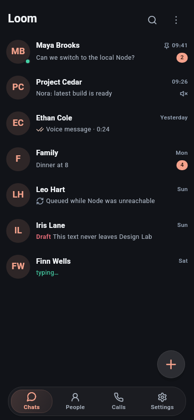</td>
    <td>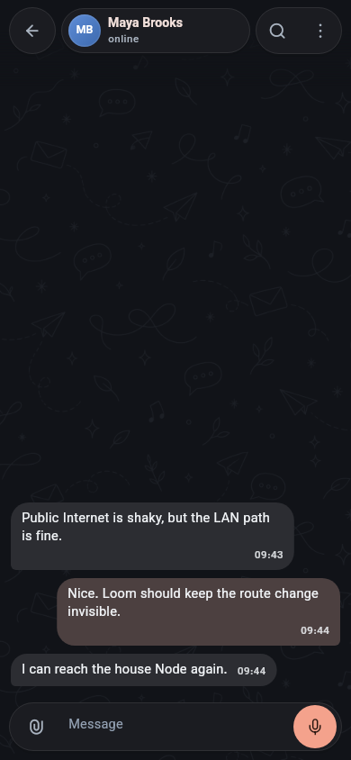</td>
    <td>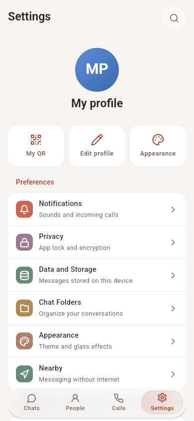</td>
  </tr>
</table>

<details>
<summary>Onboarding</summary>

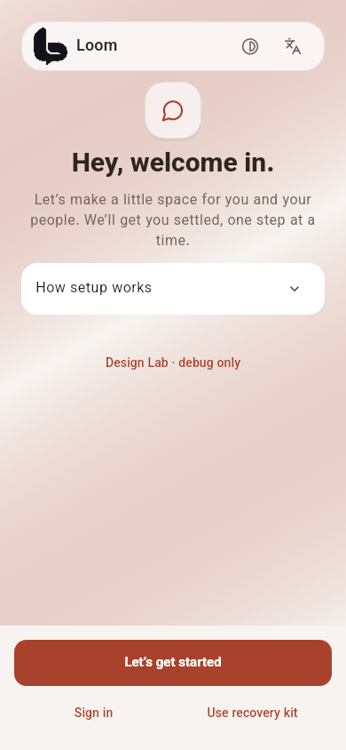

</details>

### Desktop

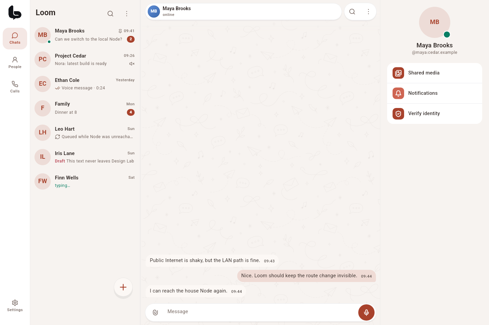

<details>
<summary>Music player</summary>

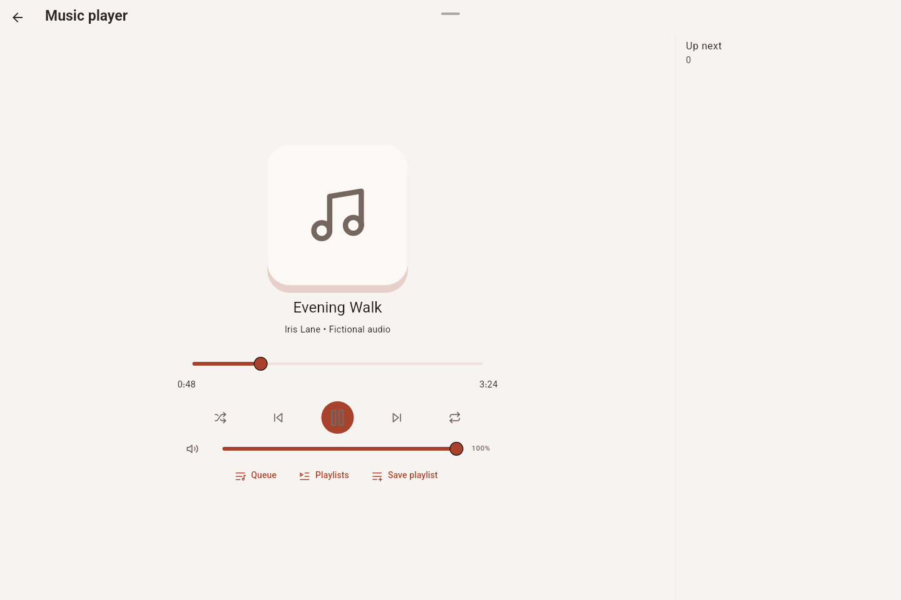

</details>

### Node manager

| Overview | Services |
| --- | --- |
| 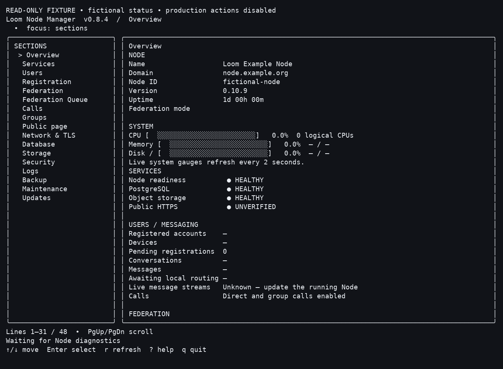 | 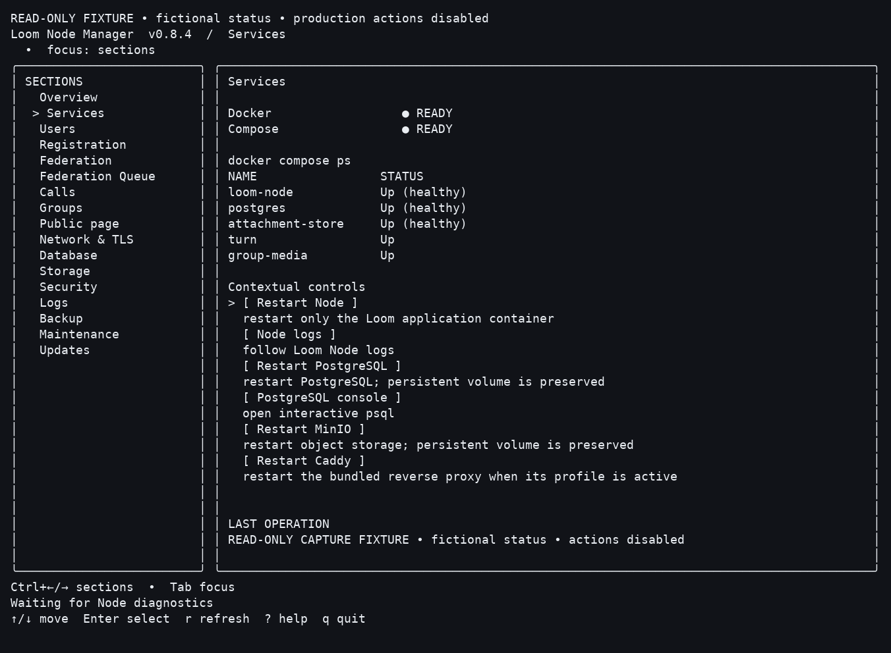 |
| **Calling** | **Updates** |
| 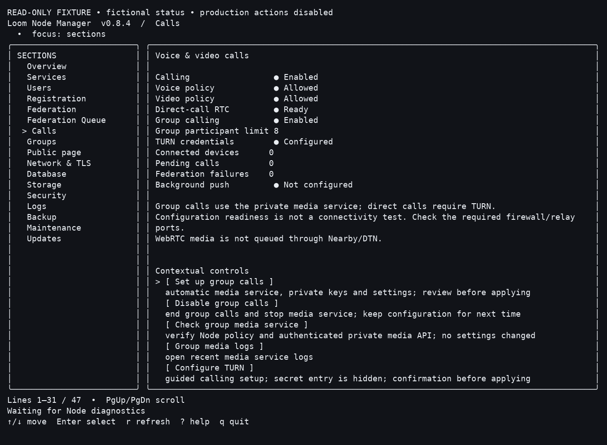 | 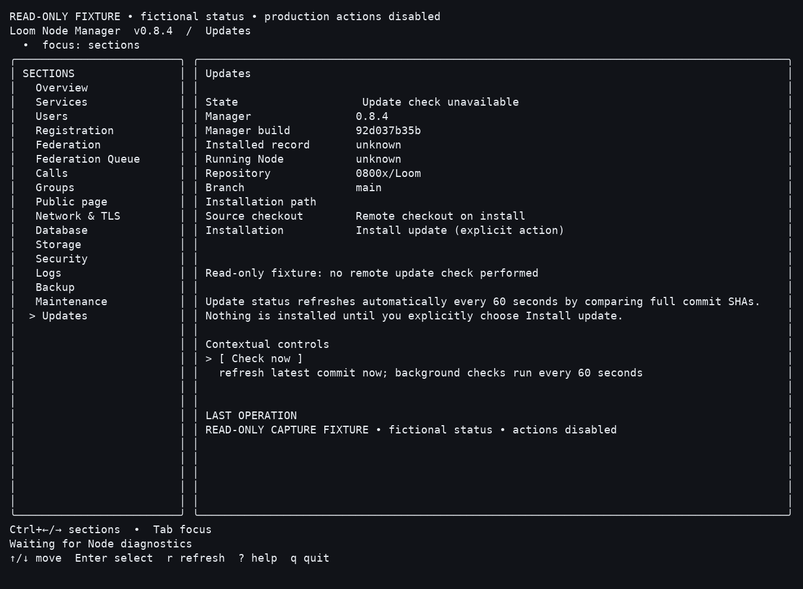 |

<details>
<summary>Public node page</summary>

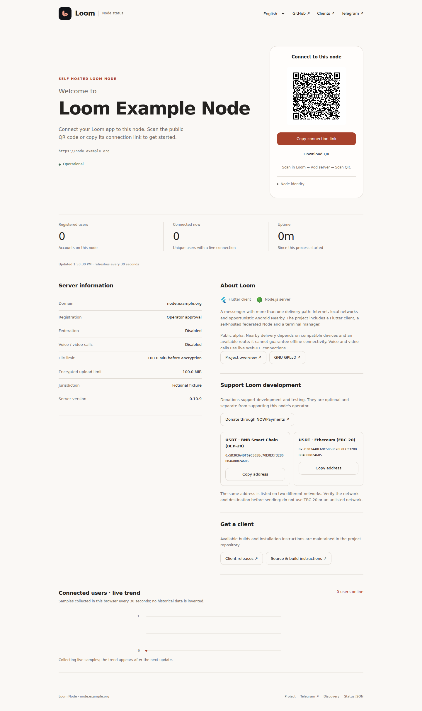

</details>

[Capture details and image hashes](docs/screenshots/loom-current/provenance.json).
Messenger widget renders do not establish native playback, device or radio support.

## Get started

1. Add a trusted Home Node using its connection link or QR code. Loom checks signed
   discovery; review a changed server fingerprint before connecting.
2. Create an identity or restore your recovery kit. Store recovery material privately.
3. Add a contact and start a conversation, or create a group on your Home Node.
4. Enable Nearby on compatible Android devices when you want local delivery.

Source and build instructions are available below. Validated installable binaries
are not yet available for every platform; see the [release status](release/README.md).

## How messages travel

**Compose → encrypt → save to the persistent outbox → deliver over a verified route.**

Messages are encrypted on the sending device. The outbox preserves queued work
across restarts, and failed sends retain ciphertext for retry. Photos, files,
audio and video are encrypted before upload; their keys travel inside the encrypted
message.

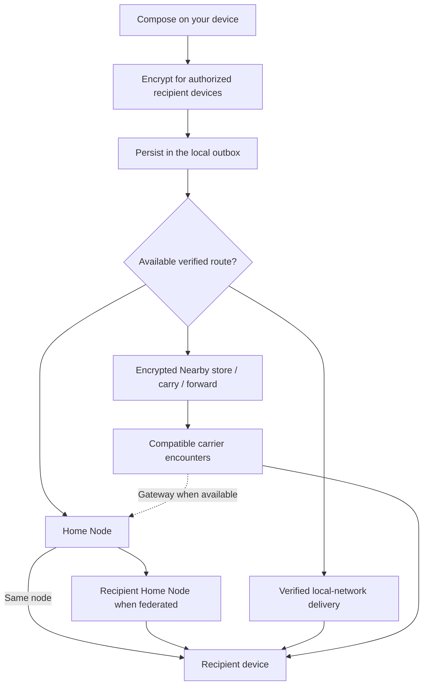

| Route | How it works |
| --- | --- |
| Home Node | Authenticated delivery and synchronization for your account |
| Federation | Verified delivery between compatible Home Nodes |
| Local network | Direct delivery using verified device information |
| Android Nearby | Encrypted packets stored, carried and forwarded during compatible device encounters |

A different route does not create a different conversation. Authentication and
key-verification failures remain failures; Loom does not bypass them by switching
transports or regenerating an identity.

### Federation: conversations across Home Nodes

Maya can use one Home Node while Ethan uses another. An address such as
`ethan@chat.example.net` tells Maya's node where to discover the recipient. The
nodes exchange encrypted messages; the receiving device decrypts them.

Discovery uses HTTPS and signed `/.well-known/loom/server` metadata. Loom checks
the endpoint, node identity and signatures before routing. Federation requests
also carry authenticated envelopes, timestamps and replay protection. A valid
signature establishes a node's identity; the operator's federation policy decides
whether that node is allowed. A changed identity is not silently trusted.

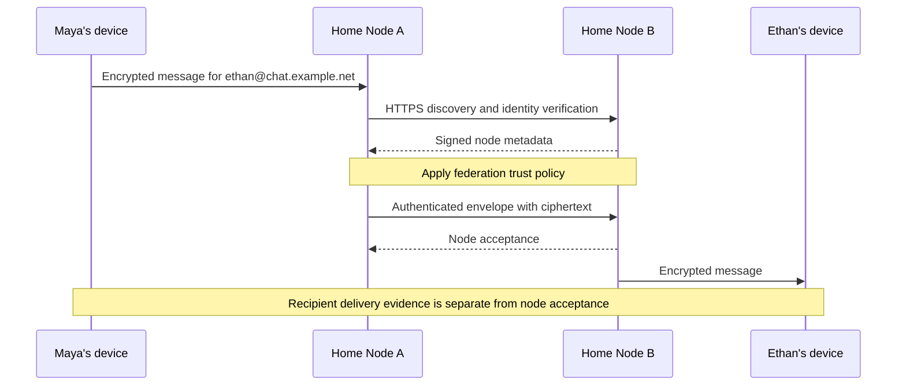

In Node Manager, open **Federation**, inspect the discovered domain and fingerprint,
then **Verify** and **Trust** the intended peer. Each operator controls their own
policy; for two-way conversations, both directions must be permitted. Remote nodes
are discovered when an address needs them, rather than through a global directory.

| Mode | Allowed peers |
| --- | --- |
| Trusted | Explicitly trusted nodes; guided setup default |
| Open | Any compatible, cryptographically verified node |
| Local | Local/private network nodes |
| Hybrid | Trusted public nodes plus local/private nodes |
| Disabled | No federation |

**Federation Queue** shows pending, retrying and failed deliveries. Temporary
network failures can retry; an authentication failure does not authorize another
transport. Federation does not make calls offline, restore lost group keys or
provide cross-node MLS membership in this alpha. See the
[federation and operator guide](docs/node-manager.md#federation).

### Store, carry and forward

A compatible Android device can hold an encrypted packet and forward it during a
later encounter. BLE, Wi-Fi Direct and Wi-Fi Aware support depends on the device
and operating system. A carrier may reach the recipient directly or reach an
available gateway.

Packets have expiry, hop and copy limits. Carrier custody means an intermediate
device holds a copy; it does not mean the recipient received it. Without a suitable
encounter before expiry, delivery can fail.

### Delivery states

| State | Meaning |
| --- | --- |
| Queued | The message is stored locally and waiting to send |
| Accepted | A node or transport accepted the outbound message |
| Delivered | Delivery evidence from the recipient exists |
| Read | Read evidence exists for that message |
| Failed | Sending needs attention or an explicit retry |

An intermediate carrier cannot produce a recipient delivery receipt. A signed
receipt from the destination can return in an encrypted packet over a later route;
the sender checks it against trusted device keys. Fully offline **read** receipts
are not implemented, so an offline delivery receipt establishes Delivered, not Read.

### Groups and calls

MLS group membership and invitations currently use a shared Home Node. An
administrator device must create the MLS Welcome before an approved member can
join. New members do not automatically receive earlier history. Account recovery
does not restore a lost MLS ratchet. See [groups and invitations](docs/groups-mls-v1.md).

Calls use authenticated signaling and live WebRTC media, with TURN where configured.
Group calls use the operator's media service. Calls cannot enter the delayed outbox
or be carried by a Nearby peer.

## Build Loom

```bash
git clone https://github.com/0800x/Loom.git
cd Loom/apps/loom
flutter pub get
flutter analyze
flutter test
flutter run
```

Flutter 3.44+ and Dart 3.12+ are required. Workflows pin their exact toolchains.
Native MLS libraries require Rust. Android builds also need the SDK, NDK and Java.

| Platform | Build targets | Packaging |
| --- | --- | --- |
| Android | ARMv7, ARM64, x86_64 | Separate APKs; optional universal APK from the build script |
| Windows | x64 | Complete application ZIP and installer |
| Linux | x64 | Application bundle with [runtime dependencies](release/linux-runtime.md) |
| macOS | Intel x64, Apple Silicon arm64 | Complete `.app` ZIP and DMG; ad-hoc engineering signing |
| Node and terminal manager | Linux amd64/arm64, Windows amd64 | Server source bundle and manager binary |

These are configured build targets. Native platform builds and physical-device
acceptance remain open where listed in the [verification report](release/VERIFICATION.md).
32-bit x86, Windows ARM64 and Linux ARM64 messenger packages are not advertised.
Node source bundles do not include offline Docker images.

### Android

From the repository root on Windows:

```powershell
powershell -NoProfile -ExecutionPolicy Bypass -File .\scripts\build-android.ps1
```

The script builds `armeabi-v7a`, `arm64-v8a` and `x86_64`. Add `-Universal` for a
combined APK. Keep the existing release keystore for future updates. Missing
release credentials do not fall back to debug signing.

See [Android signing](docs/android-release-signing.md) and the
[artifact and signing matrix](release/ARTIFACT-MATRIX.md).

## Host a node

### Guided public server setup

Use a Linux host with a domain pointing to it and inbound TCP **80/443** reachable.
The installer provisions Docker Compose, PostgreSQL, attachment storage and TLS,
then opens Node Manager. It can use bundled Caddy or an existing host Nginx; it
preserves the selected proxy on updates. TURN and group-call media have additional
ports and are configured separately in **Calls**.

From a trusted checkout, select an approved full revision and its authenticated
Git-tar checksum, then run the bootstrap **as an unprivileged user**:

```bash
export LOOM_REF=REVIEWED_FULL_COMMIT_SHA
export LOOM_SOURCE_SHA256=APPROVED_GIT_TAR_SHA256
bash scripts/install-loom-node.sh --domain chat.example.com --proxy auto
```

Replace both placeholders with approved release values. The bootstrap verifies
the source before privileged installation into `/opt/loom-node`; it does not
execute an arbitrary moving branch as root. For a private repository, configure
repository access before download. The
[installation guide](services/loom_server/deploy/README.md) explains how to obtain
and approve the checksum, Windows setup and proxy requirements.

**Easy Mode** is a separate local-development option using host Node.js, SQLite
and filesystem attachments. It is not the public deployment path; LAN connections
still need trusted HTTPS. Do not expose a development HTTP listener publicly.

### Operate with Node Manager

Run `loom` after installation (`loom-node` is also an alias). Navigate with arrow
keys, use **Tab** to switch between the sidebar, table and actions, and **Enter**
to select. **?** opens help; **r** refreshes; **q** exits. Destructive actions ask
for confirmation.

| Page | What to do |
| --- | --- |
| Overview / Services | Check readiness, runtime revision and service health |
| Users / Registrations | Review accounts and approve registration requests |
| Federation / Federation Queue | Verify peers, manage trust and inspect delivery retries |
| Calls | Configure TURN, voice/video and optional group-call media |
| Groups / Public page | Inspect groups and manage the public connection page |
| Network & TLS / Logs | Diagnose DNS, certificates, connectivity and service errors |
| Backup / Updates | Review backup operations and install an approved source update |

See the [Node Manager guide](docs/node-manager.md) for a first-run checklist,
federation setup, calling and update diagnostics.

### Source updates

Node Manager **checks automatically every 60 seconds while it is running**.
**Updates → Install update** starts the source update after operator approval;
there is no background unattended installer. The selected full commit must also
have an approved Git-tar checksum in the protected release allowlist.

The updater downloads and verifies that exact source, builds the manager,
preserves configuration and persistent data, backs up installed code, rebuilds
the Node and checks readiness plus the running revision. A moving branch cannot
change the selected update. Restarting interrupts active connections and calls;
a failed update retains the backup and does not automatically roll back.

For an existing reviewed checkout, manual recovery and prepared offline images,
follow [updates and offline transfer](docs/loom-node-update-and-offline.md).
Source bundles contain source and manager binaries; they do not contain every
Docker image or provide a fully offline fresh installation.

## Compatibility

This alpha uses the Loom protocol namespace. Earlier namespace packets, signed
headers, discovery URLs, recovery containers and protected-vault envelopes are not
accepted. Upgrade all participating clients and nodes together on a fresh test
installation. Do not overwrite an existing installation or delete its recovery
material. Export protected data using the original application first.

The 24-word entropy-to-Ed25519 key derivation is unchanged. Restoring the same
words preserves the public key and fingerprint; incompatible files and state
fail explicitly. There is no automatic conversion of conversation history or MLS
state. See [compatibility](docs/compatibility.md).

## Development

| Directory | Contents |
| --- | --- |
| `apps/loom` | Flutter messenger |
| `apps/loom_node_ui` | Desktop Node management UI |
| `packages/loom_*` | Shared UI, storage, transport and cryptographic boundaries |
| `services/loom_server` | Node runtime and deployment |
| `tools/loom_node_manager` | Terminal manager |
| `native` | Native cryptographic implementations |

Use focused changes and include relevant checks. Report the platform, revision
and reproduction steps without private conversations, credentials or recovery
material. The evaluation v2 session provider is not enabled as a production
cryptographic provider; see the [architecture notes](docs/architecture-v2.md).

## Support Loom

Help fund development, testing and device support.

<p>
  <a href="https://nowpayments.io/donation/loom" target="_blank" rel="noopener noreferrer">
    
  </a>
</p>

| Currency | Network | Address |
| --- | --- | --- |
| USDT | BNB Smart Chain · BEP-20 | `0x5D303A4DF69C5058c70E0ECf3280BDA600824685` |
| USDT | Ethereum · ERC-20 | `0x5D303A4DF69C5058c70E0ECf3280BDA600824685` |

Choose the matching network when sending. Thank you for supporting Loom.

## License

GNU General Public License, version 3 only. See [LICENSE](LICENSE) and
[COPYRIGHT](COPYRIGHT). Third-party components retain their respective licenses.

[Telegram](https://t.me/LoomMessanger) · [Documentation](docs/README.md) · [فارسی](README.fa.md)

<sub>README views count badge requests, not unique visitors. Download totals come from GitHub release assets.</sub>
