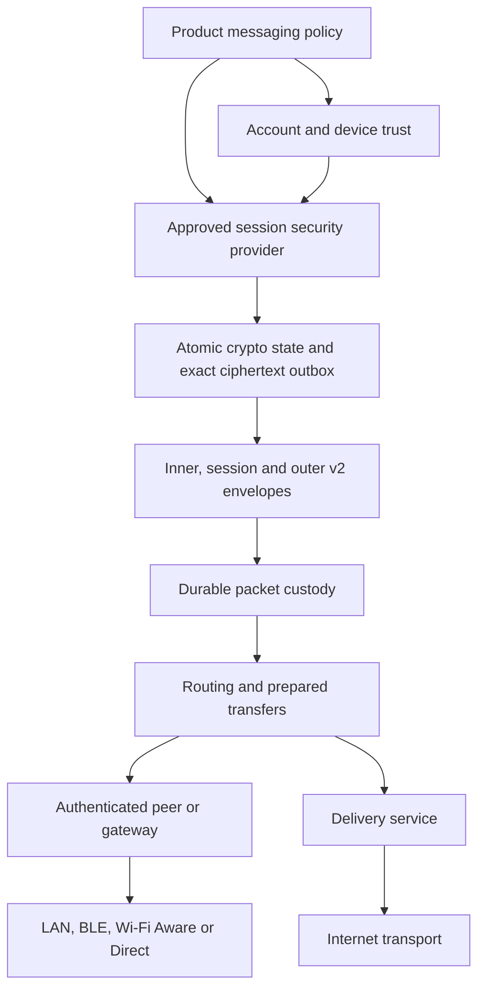

# Loom Architecture v2

Status: **implementation architecture for the experimental v2 migration**. This document is normative for boundaries/invariants in the current repository. It is not a security certification and does not by itself approve a production session protocol.

For the **currently running product paths**, corrected delivery/receipt diagrams and deployment steps, see [English](../README.md#architecture) or [فارسی](../README.fa.md#architecture). The existing direct-message path and its DTN compatibility bridge are distinct from the target session-provider stack below.

Related documents:

- `docs/delivery-v2.md`
- `docs/session-provider-evaluation-2026-09.md`
- `docs/hardware-validation-v2.md`
- `docs/adr/0001-session-provider-selection.md`
- `docs/adr/0002-envelope-v2-wire-format.md`
- `docs/adr/0003-dtn-peer-protocol-v2.md`

## 1. Goals

Architecture v2 exists to support privacy-preserving text messaging when connectivity is intermittent, path selection changes, or a message must be stored and carried by another authenticated Loom peer before a destination/gateway becomes reachable.

The design must preserve these properties across process crashes and bearer changes:

1. stable account/device identity is independent from a physical link;
2. session cryptographic state is advanced exactly with the ciphertext produced from that state;
3. exact ciphertext/PacketId retry is durable;
4. a routable packet enters durable DTN custody before a transport sees it;
5. duplicate replicas cannot mint replication authority;
6. relay/gateway/server custody is not confused with recipient delivery;
7. routing infrastructure does not receive plaintext/session keys;
8. unknown security versions and required-v2 failures do not silently downgrade.

## 2. Non-goals for the current emergency-text slice

The current v2 foundation does not attempt to finish groups/MLS, large attachments, SFU/calls, anonymity, traffic-analysis resistance, arbitrary opportunistic routing research, or every native platform bearer. Those features must not weaken the emergency text invariants.

## 3. Layer model



This is the target v2 dependency/flow model. The current product compatibility bridge does not imply production approval of an experimental session provider.

Transport MUST NOT own conversation identity, plaintext, account signing roots, recovery material, session keys or ratchet state.

## 4. Identifier semantics

### AccountId

`AccountId` is a random stable logical identifier and MUST NOT be derived from the current account signing public key. Account-key rotation/recovery therefore does not require changing the logical account identifier.

### DeviceId

`DeviceId` identifies one logical device registration. It is not a MAC address, Bluetooth address, IP, Aware `PeerHandle`, socket endpoint or platform installation token.

### DeviceKeyVersion

A device authorization explicitly identifies a monotonically versioned signing-key generation. Exact `(AccountId, DeviceId, DeviceKeyVersion)` is used by session/prekey trust decisions.

### MessageId

`MessageId` is end-to-end logical message identity and lives inside the protected inner envelope. The UI displays a logical MessageId at most once.

### PacketId

`PacketId` identifies one routable encrypted packet. Multiple physical transmissions/replicas may carry the same PacketId. Reusing a PacketId with different immutable encoded bytes is a conflict.

### TransmissionId

A prepared next-hop transfer may have its own local `TransmissionId`. It is not an E2EE message identity.

## 5. Account root trust

A server-provided directory cannot bootstrap its own root of trust.

`LoomAccountRootStoreV2` is a separate local durable trust-anchor domain. Product account bootstrap/recovery code explicitly pins an already-authenticated:

```text
AccountId
AccountKeyVersion
Ed25519 public key
validity window
```

Exact pin repetition is idempotent. The same `(AccountId, AccountKeyVersion)` cannot be rebound to different key/validity material.

`LoomEd25519AccountSignatureVerifierV2` resolves only an exact trusted root version through `LoomTrustedAccountRootResolverV2`. Unknown, expired, rolled-back or superseded versions fail closed.

## 6. Device Directory v2

Directory v2 contains account-signed device authorization/revocation records and a signed snapshot revision.

Required behavior:

- canonical domain-separated signing bytes are distinct from ordinary wire serialization;
- every authorization contains explicit account key version and device key version;
- revocation is sticky locally;
- lower directory revisions are rejected;
- conflicting records for the same device/key version are rejected;
- a newer device-key version supersedes an older version for new establishment;
- the local store accepts only cryptographically verified snapshots;
- old directory data cannot revive a revoked device.

The legacy v1 `identityId` trust store remains a migration source only; Architecture v2 does not define AccountId as equal to legacy `identityId`.

## 7. Device-authorized prekeys

The Delivery Service is a carrier, not the prekey authorization authority.

A canonical `LoomPrekeyAuthorizationStatement` binds:

- AccountId;
- DeviceId;
- DeviceKeyVersion;
- provider protocol version;
- PrekeyId;
- key kind (`one_time` or `fallback`);
- validity interval;
- SHA-256 of the exact provider bundle.

The authorized device signs those canonical bytes with its Ed25519 device signing key. `LoomAuthorizedPrekeyWireV1` is a strict transport carrier and is not itself the signed representation.

Before outbound session establishment:

1. decode the carrier;
2. resolve the exact device key/version from the local verified Directory v2 store;
3. reject unknown/revoked/superseded devices;
4. verify device signature;
5. check validity interval and provider protocol;
6. check the exact provider-bundle digest;
7. construct `LoomVerifiedPrekeyBundle`;
8. only then call the session provider.

## 8. OTK and fallback lifecycle

The Delivery Service v2 distinguishes one-time and fallback keys.

- OTK: consumed transactionally at most once by the server pool.
- fallback: returned only after OTK exhaustion and remains reusable until rotation/expiry.

Client publication uses an immutable pending batch. Account/prekey advancement and the batch are persisted before network publication. If HTTP succeeds but the client loses the acknowledgement, the exact same PrekeyIds, bundles and expiries are retried.

Safe private-material retirement is bounded by:

```text
server expiry
+ maximum claim-to-first-packet delay
+ maximum DTN packet lifetime
+ safety margin
```

The current generic evaluation default is 1 day + 7 days + 2 days after server expiry. A provider that cannot delete one exact unused private OTK MUST retain it rather than simulate deletion by resetting the account or deleting unrelated keys.

The vodozemac evaluation exposes explicit previous-fallback cleanup; the previous fallback is retained for the configured disruption window before cleanup.

## 9. Session provider boundary

`LoomSessionCryptoProvider` owns protocol-specific session operations while Loom owns durable transaction semantics.

A provider must support or safely reject:

- asynchronous outgoing establishment from externally verified prekey material;
- atomic send advancement + exact outbox staging;
- delayed/out-of-order receive within explicit implementation limits;
- replay rejection;
- remote-device revocation policy;
- first-inbound prekey bootstrap when supported;
- state import/export through the state-protection boundary.

Loom does not implement a new home-grown ratchet in Dart.

## 10. Opaque-handle provider FFI candidate

The primary vodozemac evaluation ABI v2 uses native opaque handles for live Account/Session objects.

Required ABI properties implemented by the candidate:

- integer handles have only process-local capability meaning;
- Account/Session secret state does not travel in command JSON or Dart String;
- state import/export uses bounded byte buffers only at persistence boundaries;
- Dart native input allocations are zeroed before free;
- Rust owned output buffers are zeroed before free;
- handle close removes native state;
- malformed arguments return bounded status codes;
- exported operations contain panics with `catch_unwind`;
- public key inventory and ciphertext may use JSON because they are public/protocol material, not secret provider state.

The old JSON/pickle ABI is retained only for validation/regression and is not the desired shipping bridge.

## 11. State protection

Provider/session serialized state must be protected before durable storage. `LoomSessionStateProtector` binds at minimum `(contextId, revision)` as authenticated context.

Android currently supplies a Keystore AES-256-GCM wrapping boundary with optional StrongBox use when available. The wrapping key is not stored in the crypto SQLite database.

Raw provider/session state must never be written directly to ordinary messaging/DTN storage.

## 12. Crypto database and send invariant

The security state database uses SQLite WAL and `synchronous=FULL`.

For send operation O:

```text
BEGIN IMMEDIATE
read session revision N
read operation O outbox
if exact O exists -> return exact committed record
else:
    provider encrypts and advances
    write session revision N+1 using CAS
    write exact ciphertext + MessageId + PacketId + operation O
COMMIT
```

A provider returning ciphertext without staging the exact outbox row is a transaction conflict. Retry after crash must return the exact committed record and MUST NOT advance the ratchet again.

## 13. First inbound transaction

First inbound asynchronous/prekey processing may consume local account OTK state. Therefore the transaction must atomically persist:

- advanced provider Account state;
- newly created Session state;
- replay-consumed marker;
- resulting message processing state required by the receive coordinator.

A crash before commit must leave the old Account and no new Session.

## 14. Session revocation and receive-only behavior

When a remote device version is revoked:

- no new session may be established to it;
- no new sends may use active sessions to it;
- historical session state may become receive-only for a bounded delayed-delivery period;
- receive-only state cannot become send-capable through backup restore.

Revocation markers are durable and checked within the crypto transaction.

## 15. Backup policy

Generic backup MUST exclude live send-capable ratchet state.

A device migration should establish fresh sessions. An explicitly supported historical archive may contain receive-only state, but restore must never promote it to send-capable state.

This prevents the same live chain state from being cloned onto two endpoints.

## 16. Envelope model

### InnerEnvelopeV2

End-to-end protected metadata/content including MessageId, conversation reference, sender/recipient account/device identity, content, creation time, reply reference and receipt policy.

### SessionCiphertextWireV2

Endpoint-only wrapper containing provider protocol version, opaque session locator and provider ciphertext/headers.

### OuterEnvelopeV2

Routing-visible fields only:

- PacketId;
- opaque routing/mailbox hint;
- coarse expiry bucket;
- priority;
- initial hop limit;
- current forwarding hop/copy state;
- opaque encrypted payload.

Sender/recipient/conversation/content/reply/receipt-policy data MUST NOT be copied into OuterEnvelopeV2 for convenience.

## 17. Wire format

The normative ordinary wire field map is in `packages/loom_protocol/proto/loom_envelope_v2.proto`.

The current bootstrap Dart codec is Protobuf-compatible and deliberately strict: bounded total/field sizes, duplicate singular-field rejection, invalid enum zero/unknown rejection, malformed UTF-8 rejection, non-minimal/truncated varint rejection and fail-closed known-v2 unknown-field behavior.

Raw protobuf bytes MUST NOT be used as canonical account/device signing bytes. Security-signing formats are domain-separated canonical encodings.

## 18. Durable DTN PacketStore

A committed session ciphertext is wrapped as OuterEnvelopeV2 and its exact encoded bytes enter a separate DTN SQLite database using WAL + `synchronous=FULL` before any transport is permitted to send it.

PacketStore invariants:

- exact PacketId retry is idempotent;
- changed bytes under the same PacketId conflict;
- local operation id cannot map to a second PacketId;
- source outer bytes remain immutable;
- local runtime copy budget is separate from immutable source bytes;
- expired packets are not newly admitted;
- initial local copy budget is bounded;
- terminal tombstones survive long enough to prevent resurrection/replay ambiguity.

## 19. Store-Carry-Forward and Spray-and-Wait

Routing is deterministic and transport-independent.

Priority order is conceptually:

1. authenticated direct recipient;
2. recently verified gateway supporting packet scope;
3. lower-trust claimed gateway only when policy/copy budget permits;
4. authenticated store-carry peer while in spray phase.

Each prepared transfer records copy authority before transport send. Binary split conserves:

```text
copiesGranted + copiesRetainedAfterSuccess == copiesBefore
```

A duplicate PacketId replica cannot increase the budget. One prepared in-flight transfer per PacketId prevents two simultaneous bearers from spending the same local authority.

## 20. Storage pressure

`LoomDtnStoragePressureController` measures main SQLite, WAL and SHM files.

Maintenance order:

1. mark TTL-expired packets;
2. prune only old terminal tombstones after retention;
3. re-measure pressure;
4. under elevated pressure suppress generic Store-Carry replication, retaining direct recipient and recently verified gateway opportunities;
5. under critical pressure allow direct recipient; urgent traffic may also use a recently verified gateway;
6. never silently delete a live packet merely to recover space.

The storage-pressure state is also an input to the connectivity/capability snapshot.

## 21. Replay and dedup domains

Replay is intentionally separated:

- physical/link replay is a secure-link concern;
- PacketId duplicate replicas are expected in DTN and must not inflate authority;
- MessageId dedup determines whether the user sees a logical message more than once;
- session-provider replay keys prevent reuse of already consumed session/prekey ciphertext;
- Delivery Service PacketId tombstones prevent late retry resurrection.

## 22. Receipt semantics

The following are custody/transport signals only:

- hop ACK;
- gateway accepted;
- relay/server accepted;
- mailbox transfer ACK.

Only an authenticated E2EE receipt decrypted from the intended recipient device/session may mark a message `RecipientConfirmed`/Delivered.

## 23. Connectivity capabilities

Routing MUST NOT consume a single `online/offline` enum as authoritative state.

`LoomConnectivityCapabilities` independently reports:

- Internet reachability;
- Home Node reachability;
- domestic/global relay reachability;
- LAN availability;
- supported Nearby bearers;
- authenticated nearby peer count;
- verified gateway count;
- foreground/foreground-service/background execution policy;
- storage pressure;
- battery saver state.

A legacy UI state may be derived from this snapshot but must not erase routing capability distinctions.

## 24. Nearby transport identity rule

A logical Loom peer session is independent of a physical link.

MAC address, BluetoothDevice address, IP address, DNS-SD endpoint, Wi-Fi Aware `PeerHandle`, L2CAP PSM and socket are never Loom identity.

Native implementations return short-lived opaque candidate/link handles. Raw bearers are untrusted until the Loom peer-authentication/encryption layer succeeds.

Discovery uses rotating rendezvous-derived material separate from account/device/session keys.

## 25. Android BLE

The Android BLE implementation uses LE L2CAP Connection-oriented Channels on supported Android versions, bounded scans/frames, opaque handles and a user-visible connected-device foreground service for sustained Nearby mode.

Android 12+ Nearby Bluetooth permissions are used; older scan-location permission scope is bounded by SDK version.

## 26. Android Wi-Fi Direct

The Android Wi-Fi Direct implementation uses `WifiP2pManager` DNS-SD discovery and a dynamic framed TCP listener. TXT metadata carries only protocol/rendezvous digest/port. Device addresses stay native and are never exposed as Loom identity.

The documented general `WifiP2pDnsSdServiceRequest.newInstance()` discovery flow is used and Loom filters exact service/protocol metadata in callbacks.

## 27. Android Wi-Fi Aware

The Android Wi-Fi Aware implementation uses publish/subscribe discovery and an NDP data path. The publisher opens a ServerSocket and requests an Aware network with peer/passphrase/port; the subscriber requests the matching data path and uses `WifiAwareNetworkInfo` peer IPv6/port to create the framed socket.

PeerHandle, Network and IP remain native bearer details.

## 28. Android endpoint policy

- release cleartext traffic is disabled;
- application backup is disabled for app data containing crypto state;
- incoming-call public lock-screen version is generic rather than caller-address plaintext;
- sustained Nearby mode uses an explicit foreground-service lifetime;
- WorkManager/background jobs must not be used to emulate an unrestricted permanent mesh radio.

## 29. Delivery Service v2

`/api/v2` is additive to `/api/v1` and provides opaque mailbox/prekey/packet custody.

The server may enforce authentication, active-device ownership, expiry, quota, idempotency and abuse-accounting metadata, but it is not an E2EE participant.

Prekey material is opaque device-authorized carrier data. Server prekey publication does not itself authorize a device.

Stable PacketId exact enqueue is idempotent; conflicting reuse fails. ACKed packet tombstones persist until packet TTL so a late retry cannot resurrect relay work.

## 30. Product migration / downgrade policy

Default product mode remains `legacyOnly` while the production provider gate is open.

A product surface may explicitly select `v2Required`. In that mode:

- v2 runtime/provider/state protection must be available;
- failures are surfaced;
- legacy direct-message fallback MUST NOT run automatically.

This makes migration explicit and prevents security-version downgrade hidden inside generic retry code.

## 31. Validation strategy

Hosted CI status is not an architecture invariant. The repository provides strict local entry points:

```bash
bash scripts/validate-architecture-v2.sh
```

and Windows:

```powershell
.\scripts\validate-architecture-v2.ps1
```

The local validator is defined to cover Dart/Flutter analysis/tests, Rust format/clippy/tests/release build, Delivery Service v2 tests and Android debug assembly.

Source presence does not prove those commands passed on an unavailable toolchain. Release evidence must record the actual validator result and commit SHA.

## 32. Chaos/property coverage

The repository includes deterministic malformed/randomized regression suites for:

- strict envelope mutation/failure behavior;
- PacketStore exact retry and collision rejection;
- Spray-and-Wait copy conservation;
- storage-pressure routing;
- malformed native-provider input/panic containment;
- crash rollback and exact ciphertext/prekey retry;
- durable A → B → restart B → C forwarding.

These tests complement but do not replace real-device/network chaos.

## 33. Real-device release evidence

`docs/hardware-validation-v2.md` defines the physical-device matrix for BLE, Wi-Fi Direct, Wi-Fi Aware, Doze/background policy, process restart, storage pressure, battery and malicious/noisy peers.

Code presence, emulator behavior or a successful compile MUST NOT be reported as physical validation.

## 34. Provider-specific DTN limits

The pinned vodozemac 0.10.0 evaluation characterizes approximately:

- 2000 maximum forward gap in the evaluated path;
- 40 retained skipped message keys per receiving chain;
- 5 receiving chains.

These are provider-selection constraints. Loom routing must not promise arbitrary out-of-order decryptability beyond the selected provider implementation.

## 35. Current implementation status

Implemented in the v2 branch foundation:

- random AccountId/DeviceId and signed Directory-v2 contracts;
- trusted account-root store + Ed25519 account signature verifier;
- sticky device revocation/version cache;
- device-authorized prekeys;
- provider-neutral sessions/state/backup/retirement contracts;
- vodozemac JSON regression PoC and opaque-handle FFI candidate;
- handle-provider prekey publication/replenishment/fallback lifecycle;
- atomic crypto store/outbox;
- Envelope-v2 models/codec;
- messaging send/receive/custody/receipt orchestration;
- durable DTN PacketStore/router/transfer/replica/storage-pressure foundation;
- Delivery Service v2;
- Android Keystore state wrapping;
- Android BLE, Wi-Fi Direct and Wi-Fi Aware native bearer implementations;
- capability-based connectivity snapshot;
- product no-downgrade policy;
- local validation scripts;
- real-device validation runbook.

## 36. Remaining external production gates

The following must not be marked complete by merely adding source code:

1. run the strict local validator on real configured toolchains and resolve any compiler/platform findings;
2. execute physical BLE/Aware/Direct/OEM/Doze/battery/storage tests;
3. collect long-running malicious-peer/chaos evidence;
4. approve the exact production provider/protocol and distribution/license/support model;
5. review provider-state upgrade migration against real released provider versions;
6. perform independent security review/audit of the exact composition;
7. finish release signing/notarization/SBOM/reproducibility and native bearers for selected non-Android platforms.

Until those gates close, Architecture v2 remains a experimental foundation rather than an audited production security claim.
